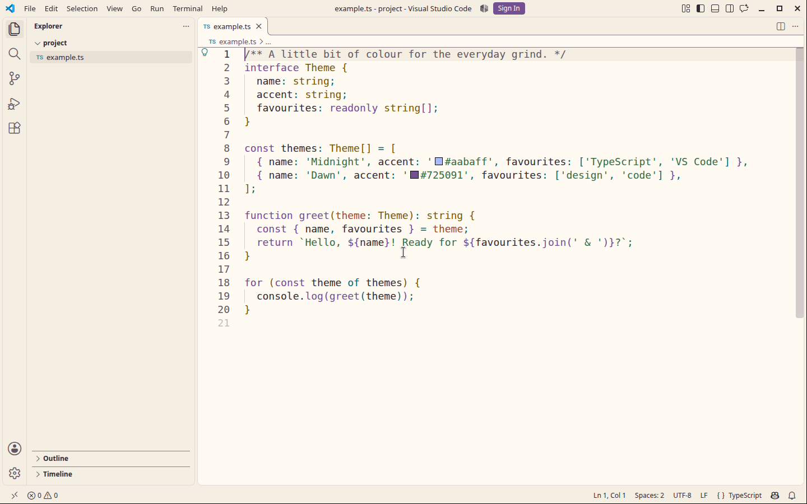
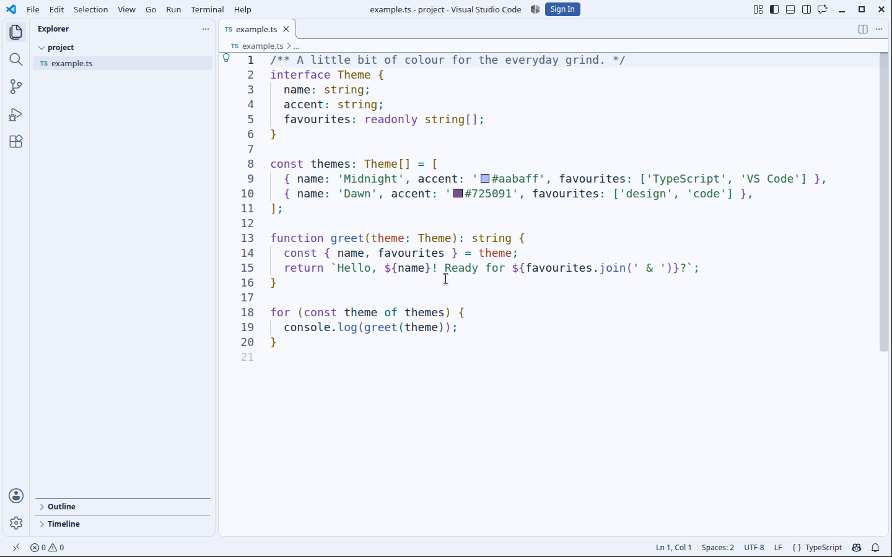
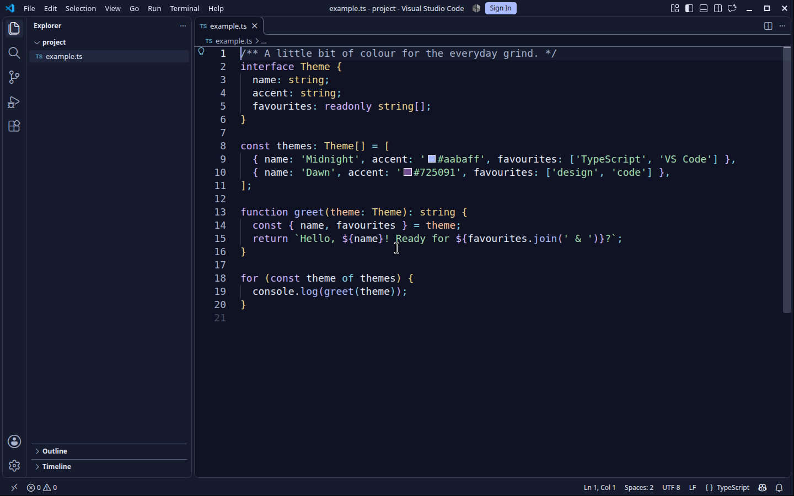

# KiraLume

Three colour themes for your VS Code workspace. Pick your light, set your mood, and make it yours.

|                                          Dawn                                           |                                              Daylight                                               |                                              Midnight                                               |
| :-------------------------------------------------------------------------------------: | :-------------------------------------------------------------------------------------------------: | :-------------------------------------------------------------------------------------------------: |
| [](assets/screenshots/dawn.png) | [](assets/screenshots/daylight.png) | [](assets/screenshots/midnight.png) |
|                        Warm paper tones with teal and burgundy.                         |                                  Cool light with blue and purple.                                   |                                   Deep navy with blue and violet.                                   |

Select a preview to see it at full size. KiraLume colours the editor, terminal and surrounding workbench, including source control, debugging, notebooks and settings. Syntax and semantic colours work with the language support installed in VS Code.

## Make it yours

Open **Preferences: Open User Settings (JSON)** and add your own colours. For example, these settings select Midnight and adjust its editor background, cursor and comments:

```json
{
  "workbench.colorTheme": "KiraLume Midnight",
  "workbench.colorCustomizations": {
    "[KiraLume Midnight]": {
      "editor.background": "#101323",
      "editorCursor.foreground": "#aabaff"
    }
  },
  "editor.tokenColorCustomizations": {
    "[KiraLume Midnight]": {
      "comments": "#a5b0ca"
    }
  }
}
```

For automatic switching with your system colour scheme, choose your preferred light and dark themes:

```json
{
  "window.autoDetectColorScheme": true,
  "workbench.preferredLightColorTheme": "KiraLume Daylight",
  "workbench.preferredDarkColorTheme": "KiraLume Midnight"
}
```

If a colour looks unexpected, check the file's language mode and run **Developer: Inspect Editor Tokens and Scopes** from the Command Palette. Language extensions supply syntax scopes and semantic tokens; some extension webviews use their own colours.

## Feedback

Have a bug or an idea? [Open an issue](https://github.com/kirasync2748/KiraLume/issues) and include a screenshot when it helps show what you mean.
